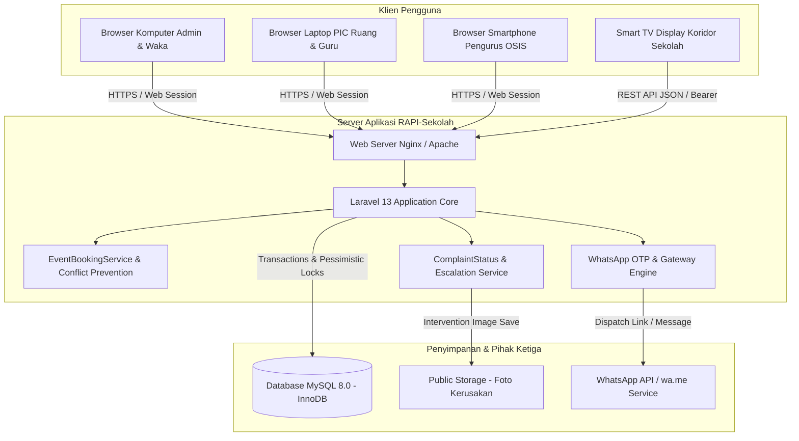
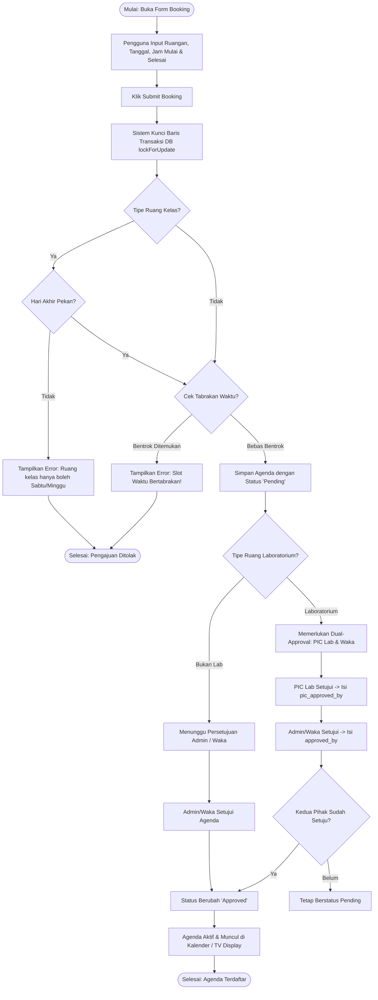
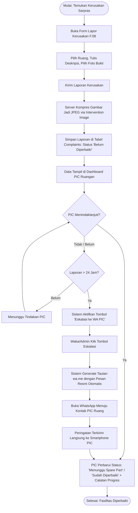
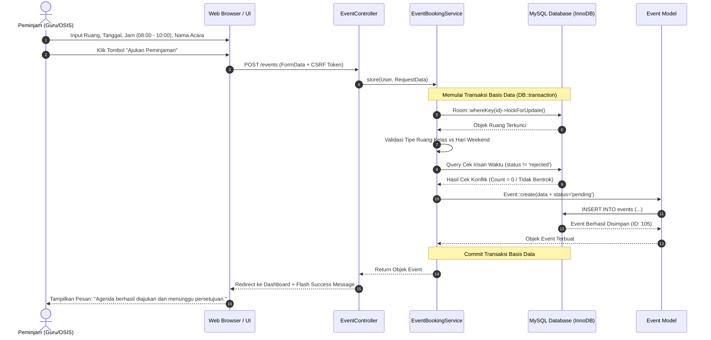
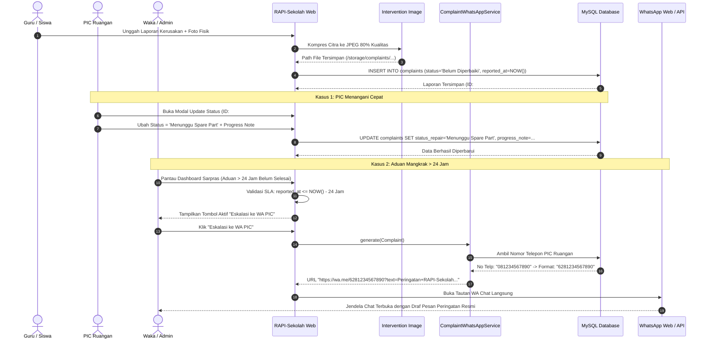
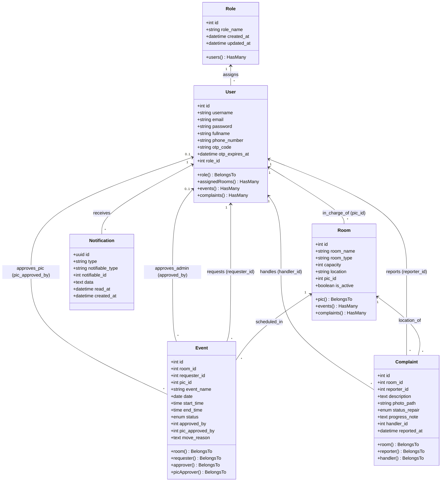

# Spesifikasi Kebutuhan Perangkat Lunak (Software Requirements Specification)

---

## Untuk: **RAPI-Sekolah**
### *(Sistem Manajemen Agenda Peminjaman Ruang & Penanganan Pengaduan Fasilitas Sekolah)*
**Versi:** 1.0 Disetujui  
**Disiapkan oleh:** Dirya & Tim Pengembang Perangkat Lunak (UKK RPL)  
**Organisasi:** SMK Negeri / Lembaga Pendidikan Kejuruan  
**Tanggal Dibuat:** 2 November 2026  

---

## Table of Contents

- [Revision History](#riwayat-perubahan)
- [1. Pendahuluan](#1-pendahuluan)
  - [1.1 Tujuan](#11-tujuan)
  - [1.2 Definisi dan Istilah](#12-definisi-dan-istilah)
  - [1.3 Suggestions Pembaca yang Disarankan Membaca Dokumen Ini](#13-suggestions-pembaca-yang-disarankan-membaca-dokumen-ini)
  - [1.4 Ruang Lingkup Sistem](#14-ruang-lingkup-sistem)
  - [1.5 Sistem Penomoran](#15-sistem-penomoran)
  - [1.6 Referensi](#16-referensi)
  - [1.7 Ikhtisar Dokumen](#17-ikhtisar-dokumen)
- [2. Deskripsi Umum Sistem](#2-deskripsi-umum-sistem)
  - [2.1 Perspektif Perangkat Lunak](#21-perspektif-perangkat-lunak)
  - [2.2 Fungsi Perangkat Lunak](#22-fungsi-perangkat-lunak)
  - [2.3 Karakteristik dan Klasifikasi Pengguna](#23-karakteristik-dan-klasifikasi-pengguna)
  - [2.4 Lingkungan Operasi](#24-lingkungan-operasi)
  - [2.5 Batasan Desain dan Implementasi](#25-batasan-desain-dan-implementasi)
  - [2.6 Dokumentasi bagi Pengguna](#26-dokumentasi-bagi-pengguna)
  - [2.7 Asumsi dan Ketergantungan](#27-asumsi-dan-ketergantungan)
- [3. Kebutuhan Antarmuka Eksternal](#3-kebutuhan-antarmuka-eksternal)
  - [3.1 Antarmuka Pengguna](#31-antarmuka-pengguna)
  - [3.2 Antarmuka Perangkat Keras](#32-antarmuka-perangkat-keras)
  - [3.3 Antarmuka Perangkat Lunak](#33-antarmuka-perangkat-lunak)
  - [3.4 Antarmuka Komunikasi](#34-antarmuka-komunikasi)
- [4. Fitur Sistem](#4-fitur-sistem)
  - [4.1 Autentikasi Pengguna & Manajemen Sesi](#41-fitur-1-autentikasi-pengguna--manajemen-sesi)
  - [4.2 Pemulihan Kata Sandi Mandiri via WhatsApp OTP](#42-fitur-2-pemulihan-kata-sandi-mandiri-via-whatsapp-otp)
  - [4.3 Pengajuan Peminjaman Ruang & Deteksi Pencegahan Tabrakan Waktu](#43-fitur-3-pengajuan-peminjaman-ruang--deteksi-pencegahan-tabrakan-waktu)
  - [4.4 Verifikasi & Persetujuan Bertingkat (Dual-Approval Lab & Single Approval)](#44-fitur-4-verifikasi--persetujuan-bertingkat-dual-approval-lab--single-approval)
  - [4.5 Pemindahan Ruangan / Hak Veto Waka dengan Notifikasi Otomatis](#45-fitur-5-pemindahan-ruangan--hak-veto-waka-dengan-notifikasi-otomatis)
  - [4.6 Pelaporan Kerusakan Sarana Prasarana dengan Kompresi Foto Bukti](#46-fitur-6-pelaporan-kerusakan-sarana-prasarana-dengan-kompresi-foto-bukti)
  - [4.7 Manajemen Status Perbaikan Fasilitas & Catatan Progres oleh PIC](#47-fitur-7-manajemen-status-perbaikan-fasilitas--catatan-progres-oleh-pic)
  - [4.8 Eskalasi Pengaduan Kerusakan Kritis via WhatsApp PIC Ruangan](#48-fitur-8-eskalasi-pengaduan-kerusakan-kritis-via-whatsapp-pic-ruangan)
  - [4.9 Kalender Publik Read-Only & Smart TV Display Agenda Sekolah Real-Time](#49-fitur-9-kalender-publik-read-only--smart-tv-display-agenda-sekolah-real-time)
  - [4.10 Manajemen Master Data Pengguna & Ruangan](#410-fitur-10-manajemen-master-data-pengguna--ruangan)
  - [4.11 Rekapitulasi & Cetak Laporan Resmi](#411-fitur-11-rekapitulasi--cetak-laporan-resmi)
- [5. Kebutuhan Non Fungsional Lainnya](#5-kebutuhan-non-fungsional-lainnya)
  - [5.1 Kebutuhan Kinerja](#51-kebutuhan-kinerja)
  - [5.2 Kebutuhan Keamanan](#52-kebutuhan-keamanan)
  - [5.3 Kebutuhan Perlindungan Keamanan (Security Protection)](#53-kebutuhan-perlindungan-keamanan-security-protection)
  - [5.4 Atribut Kualitas Perangkat Lunak](#54-atribut-kualitas-perangkat-lunak)
  - [5.5 Aturan Bisnis (Business Rules)](#55-aturan-bisnis-business-rules)
- [6. Kebutuhan Lain](#6-kebutuhan-lain)
- [Appendix A: Model Analisa (UML Diagrams)](#appendix-a-model-analisa)
  - [A.1 Use Case Diagram](#a1-use-case-diagram)
  - [A.2 Use Case Description](#a2-use-case-description)
  - [A.3 Activity Diagram](#a3-activity-diagram)
  - [A.4 Sequence Diagram](#a4-sequence-diagram)
  - [A.5 Class Diagram](#a5-class-diagram)
- [Appendix B: Desain Antarmuka Sistem (Wireframe & UI/UX)](#appendix-b-desain-antarmuka-sistem)
  - [B.1 Panduan Desain & Visual Tokens](#b1-panduan-desain--visual-tokens)
  - [B.2 Wireframe Skematis Formulir Booking](#b2-wireframe-skematis-formulir-booking)
  - [B.3 Antarmuka Dashboard Admin & Waka](#b3-antarmuka-dashboard-admin--waka)
  - [B.4 Antarmuka Penanganan Kerusakan & Eskalasi WhatsApp](#b4-antarmuka-penanganan-kerusakan--eskalasi-whatsapp)
  - [B.5 Antarmuka Smart TV Display & Kalender Publik](#b5-antarmuka-smart-tv-display--kalender-publik)
- [Appendix C: Daftar Yang Akan Ditentukan Kemudian (TBD)](#appendix-c-daftar-yang-akan-ditentukan-kemudian)

---

## Riwayat Perubahan

| Nama | Tanggal | Alasan Perubahan | Versi |
| :--- | :--- | :--- | :--- |
| **Dirya & Tim Pengembang** | 20 Oktober 2026 | Inisiasi spesifikasi kebutuhan awal modul agenda dan sarpras UKK | 0.1 |
| **Dirya & Tim Pengembang** | 24 Oktober 2026 | Penambahan spesifikasi WhatsApp OTP, Dual-Approval Lab, dan Conflict Prevention Engine | 0.8 |
| **Dirya & Tim Pengembang** | 2 November 2026 | Finalisasi dokumen SRS lengkap v1.0 disetujui (dilengkapi UML Diagram, Wireframe, UI/UX Mockup) | 1.0 |

---

# 1. Pendahuluan

### 1.1 Tujuan
Dokumen Spesifikasi Kebutuhan Perangkat Lunak (SKPL / SRS) ini disusun sebagai acuan formal dalam pengembangan, verifikasi, dan pengujian sistem informasi **RAPI-Sekolah** *(Sistem Manajemen Agenda Peminjaman Ruang & Penanganan Pengaduan Fasilitas Sekolah)* versi 1.0. Dokumen ini mendefinisikan seluruh kebutuhan fungsional, kebutuhan non-fungsional, batasan perancangan arsitektur, skema basis data, model analisa UML, serta spesifikasi antarmuka visual (wireframe & UI/UX) yang diimplementasikan pada proyek Uji Kompetensi Keahlian (UKK) Rekayasa Perangkat Lunak.

### 1.2 Definisi dan Istilah
Guna memberikan pemahaman yang seragam antara pemangku kepentingan (*stakeholders*), analis, pemrogram, dan penguji, berikut adalah istilah dan akronim yang digunakan:

| Istilah | Definisi |
| :--- | :--- |
| **RAPI-Sekolah** | Nama perangkat lunak aplikasi terintegrasi untuk pengelolaan Ruang, Agenda, Peminjaman, dan Inventaris/Pengaduan fasilitas sekolah. |
| **SRS / SKPL** | *Software Requirements Specification* / Spesifikasi Kebutuhan Perangkat Lunak standar IEEE Std 830-1998 / IEEE 1233. |
| **RBAC** | *Role-Based Access Control*, metode pembatasan hak akses sistem berdasarkan peran pengguna (*Admin, Waka, PIC, Guru, Organisasi, Siswa*). |
| **PIC Ruangan** | *Person in Charge*, petugas/guru penanggung jawab fasilitas ruang tertentu (misal: PIC Lab Komputer, PIC Sarpras). |
| **Waka** | Wakil Kepala Sekolah (khususnya Waka Sarana & Prasarana atau Waka Kurikulum) yang memegang kewenangan tertinggi atas izin penggunaan ruang dan hak veto pemindahan agenda. |
| **Dual-Approval** | Mekanisme persetujuan ganda yang mewajibkan persetujuan dari PIC Ruang DAN Waka/Admin (misalnya pada peminjaman Laboratorium Praktikum). |
| **Conflict Detection** | Algoritma pencegahan tabrakan agenda peminjaman ruangan pada tanggal dan rentang waktu yang saling bersinggungan (*overlapping time slot*). |
| **OTP** | *One-Time Password*, kode verifikasi 6 digit numerik unik sekali pakai dengan batas kedaluwarsa 10 menit untuk pemulihan kata sandi via WhatsApp. |
| **Eskalasi WhatsApp** | Mekanisme otomatis pembuatan tautan `wa.me` berformat resmi ke kontak PIC Ruangan apabila laporan kerusakan belum tertangani lebih dari 24 jam. |
| **Sanctum** | Paket autentikasi token API ringan bawaan Laravel untuk mengamankan *endpoint* layanan seluler dan layar display TV. |
| **Pessimistic Locking** | Teknik transaksi basis data menggunakan klausul `SELECT ... FOR UPDATE` (`lockForUpdate()`) guna menjamin integritas data terhadap *race condition*. |

### 1.3 Suggestions Pembaca yang Disarankan Membaca Dokumen Ini
Dokumen ini disusun untuk dipelajari oleh berbagai kelompok audiens:
1. **Analis Sistem (*System Analyst*)**: Memahami keselarasan proses bisnis, model data, Use Case, dan Sequence Diagram dengan kebutuhan operasional sekolah.
2. **Pengembang Perangkat Lunak (*Software Developer / Programmer*)**: Dijadikan acuan utama dalam mengimplementasikan *route*, controller, Eloquent model, middleware, servis bisnis, algoritma pencegahan tabrakan, dan integrasi WhatsApp.
3. **Penguji Perangkat Lunak (*Software Tester / QA*)**: Menyusun skenario pengujian unit (*unit testing*), pengujian integrasi (*integration test*), dan *User Acceptance Testing* (UAT) berdasarkan butir kebutuhan fungsional (KF) dan non-fungsional (KnF).
4. **Asesor / Penguji UKK**: Melakukan audit kelengkapan fungsionalitas aplikasi terhadap instrumen uji kompetensi bidang rekayasa perangkat lunak.
5. **Administrator Sistem & Waka Sekolah**: Mengetahui batasan kewenangan hak akses dan prosedur operasional sistem.

Urutan pembacaan disarankan dimulai dari Bab 1 (Pendahuluan), Bab 2 (Deskripsi Umum Sistem), Bab 4 (Fitur Sistem), dilanjutkan dengan Appendix A (Model Analisa UML) dan Appendix B (Desain Antarmuka).

### 1.4 Ruang Lingkup Sistem
Sistem **RAPI-Sekolah** mencakup otomatisasi dan transparansi tata kelola sarana prasarana sekolah, yang meliputi subsistem:
1. **Subsistem Peminjaman Ruangan & Agenda**: Pengajuan jadwal, validasi ketersediaan ruang, deteksi tabrakan waktu berbasis algoritma interval, aturan akhir pekan untuk ruang kelas, persetujuan tunggal dan bertingkat (*dual-approval* lab), serta hak veto pemindahan ruangan (*reschedule/move*) oleh Waka/Admin dengan notifikasi otomatis.
2. **Subsistem Pengaduan Kerusakan Fasilitas**: Pelaporan kerusakan sarana prasarana disertai kompresi otomatis foto bukti (JPEG), tracking status perbaikan (*Belum Diperbaiki, Menunggu Spare Part, Sudah Diperbaiki*), riwayat catatan progres oleh PIC, dan eskalasi otomatis via WhatsApp bila aduan melampaui SLA 24 jam.
3. **Subsistem Transparansi Publik & Smart Display**: Tampilan kalender publik *read-only* bagi warga sekolah/siswa, serta *endpoint* API Display Smart TV di lobi sekolah untuk penayangan agenda ruang real-time hari berjalan.
4. **Subsistem Administrasi & Pelaporan**: Manajemen pengguna, pengelolaan master ruangan & penugasan PIC, reset kata sandi mandiri via WhatsApp OTP, dan pencetakan rekapitulasi laporan resmi (PDF/Print) berkop sekolah.

Sistem tidak mencakup transaksi keuangan sewa komersial maupun pengadaan pembelian barang baru (*procurement tender*).

### 1.5 Sistem Penomoran
Dokumen ini menerapkan sistem penomoran terstandarisasi untuk mempermudah penelusuran (*traceability matrix*):

| Kategori | Format Penomoran | Keterangan & Contoh |
| :--- | :--- | :--- |
| **Use Case** | `UC.xx` | `xx` adalah nomor urut use case. Contoh: `UC.01` (Autentikasi Pengguna), `UC.03` (Peminjaman Ruang). |
| **Kebutuhan Fungsional** | `KF.xx.yy` / `REQ-xx` | `xx` adalah kode modul, `yy` adalah butir fungsi. Contoh: `KF.03.01` (Deteksi bentrok jadwal). |
| **Kebutuhan Non-Fungsional**| `KnF.xx.yy` | `xx` adalah klasifikasi kualitas. Contoh: `KnF.02.01` (Enkripsi password via Bcrypt). |
| **Form Antarmuka** | `F.xx` | `xx` adalah nomor urut halaman formulir antarmuka. Contoh: `F.01` (Form Login), `F.03` (Form Peminjaman). |
| **Laporan Keluaran** | `L.xx` | `xx` adalah nomor laporan cetak. Contoh: `L.01` (Rekapitulasi Agenda & Pengaduan Sarpras). |

### 1.6 Referensi
1. **IEEE Std 830-1998**: *IEEE Recommended Practice for Software Requirements Specifications*.
2. **IEEE Std 1233-1998 Edition**: *IEEE Guide for Developing System Requirements Specifications*.
3. **Panduan Penyelenggaraan Uji Kompetensi Keahlian (UKK)** SMK Bidang Keahlian Rekayasa Perangkat Lunak.
4. **Dokumentasi Resmi Laravel Framework v13.x**: *Routing, Eloquent ORM, Sanctum, Notifications, and Database Transactions*.
5. **Tegarden, Wixon, and Dennis (2015)**: *Systems Analysis and Design with UML Version 2.0 and Object-Oriented Approach*.

### 1.7 Ikhtisar Dokumen
Dokumen ini disusun dalam 6 bab utama serta 3 lampiran teknis (*Appendix*):
- **Bab 1**: Pendahuluan, latar belakang, tujuan, ruang lingkup, dan konvensi penomoran dokumen.
- **Bab 2**: Deskripsi umum sistem, konteks operasional, aktor pengguna, batasan desain, dan asumsi.
- **Bab 3**: Kebutuhan antarmuka eksternal (UI, Hardware, Software, Komunikasi).
- **Bab 4**: Spesifikasi mendalam seluruh fitur fungsional (deskripsi, stimulus/respons, dan functional requirements).
- **Bab 5**: Kebutuhan non-fungsional mencakup performa, keamanan, integritas, keandalan, dan aturan bisnis.
- **Bab 6**: Kebutuhan pendukung lainnya (basis data dan pencatatan audit).
- **Appendix A**: Model analisa UML lengkap (*Use Case Diagram, Use Case Description, Activity Diagram, Sequence Diagram, Class Diagram*).
- **Appendix B**: Desain wireframe skematis dan visualisasi UI/UX Mockup high-fidelity yang diimplementasikan.
- **Appendix C**: Daftar TBD (*To Be Determined*).

---

# 2. Deskripsi Umum Sistem

### 2.1 Perspektif Perangkat Lunak
RAPI-Sekolah merupakan perangkat lunak berbasis web modern yang dirancang independen (*self-contained*) dengan arsitektur terpusat (*client-server*). Sistem ini menghubungkan seluruh unit di lingkungan sekolah (Waka Sarpras, Petugas PIC Ruang/Laboratorium, Dewan Guru, Organisasi Kesiswaan/OSIS, serta Siswa). Perangkat lunak ini menyediakan dua gerbang antarmuka: antarmuka berbasis Web (Blade) untuk manajemen pengguna desktop/mobile, serta Application Programming Interface (REST API) yang diamankan dengan Laravel Sanctum untuk konsumsi data layar Smart TV lorong sekolah dan integrasi pesan WhatsApp Gateway.



### 2.2 Fungsi Perangkat Lunak
Fungsi utama yang disediakan oleh perangkat lunak RAPI-Sekolah antara lain:
1. **Autentikasi Terpusat & Pemulihan Akun**: Login multi-role, logout aman, serta reset password mandiri via WhatsApp OTP 6 digit.
2. **Manajemen Peminjaman Ruang**: Pengajuan jadwal, pengecekan tabrakan otomatis (*anti-clash verification*), dan pembatasan peminjaman ruang kelas hanya pada hari Sabtu dan Minggu.
3. **Persetujuan Ganda (*Dual-Approval*)**: Validasi persetujuan terpisah dari PIC Laboratorium dan Waka/Admin untuk ruangan bertipe laboratorium.
4. **Hak Veto & Pemindahan Agenda Ruangan**: Pemindahan agenda oleh Waka ke ruang lain dengan pencatatan alasan (*move reason*) dan notifikasi internal otomatis.
5. **Pelaporan & Tracking Kerusakan Sarpras**: Pelaporan dengan unggah foto kompresi otomatis, perbaruan status perbaikan (*Belum Diperbaiki, Menunggu Spare Part, Sudah Diperbaiki*), dan catatan progres penanganan.
6. **Eskalasi Insiden via WhatsApp**: Pembuatan tautan peringatan WhatsApp resmi langsung ke kontak PIC penanggung jawab jika perbaikan tertunda lebih dari 24 jam.
7. **Kalender Publik & Smart TV Display**: Tampilan jadwal kegiatan interaktif untuk siswa serta penayangan agenda harian otomatis pada layar TV lobi.
8. **Master Data & Rekapitulasi Cetak**: Pengelolaan data pengguna (*CRUD, reset password*), manajemen ruangan, serta cetak laporan PDF/cetak fisik rekapitulasi agenda dan kerusakan fasilitas.

### 2.3 Karakteristik dan Klasifikasi Pengguna
Hak akses pengguna diatur secara tegas menggunakan tabel relasi `roles` dan middleware `EnsureRole`:

| Kelompok Pengguna | Hak Akses & Tanggung Jawab Utama | Tingkat Kemahiran Teknis |
| :--- | :--- | :--- |
| **Admin / Waka** | Memiliki kewenangan tertinggi: mengelola master data pengguna dan ruangan, menyetujui/menolak agenda, memindahkan ruangan peminjam (*veto reschedule*), memicu eskalasi WhatsApp laporan kerusakan, dan mencetak rekapitulasi menyeluruh. | Menengah (Menguasai operasional komputer dan administrasi web). |
| **PIC Ruangan** | Mengelola dan menyetujui peminjaman ruangan khusus laboratorium yang menjadi tanggung jawabnya, memperbarui status perbaikan kerusakan fasilitas yang dilaporkan, menuliskan catatan progres penanganan, serta mengajukan agenda ruang. | Menengah (Guru kejuruan/laboran/staf sarpras). |
| **Guru & Organisasi (OSIS)** | Mengajukan peminjaman ruangan sesuai kebutuhan pembelajaran/kegiatan, melaporkan sarana rusak disertai unggahan foto bukti, memantau status persetujuan agenda dan status perbaikan yang dilaporkan. | Dasar (Dapat mengoperasikan formulir web standar pada PC/ponsel). |
| **Siswa / Publik** | Akses *read-only* tanpa perlu login: melihat kalender agenda publik dan informasi penggunaan ruangan pada layar display TV sekolah. | Dasar (Akses informasi umum). |

### 2.4 Lingkungan Operasi
1. **Platform Server**:
   - Sistem Operasi: Linux (Ubuntu Server 22.04 LTS) atau Windows Server / Windows dengan stack Laragon.
   - Web Server: Nginx 1.24+ atau Apache 2.4+.
   - Runtime Environment: PHP versi 8.2 atau 8.3 dengan ekstensi aktif: `pdo_mysql`, `mbstring`, `fileinfo`, `gd` / `imagick`, `curl`, `openssl`.
   - Database Management System: MySQL versi 8.0+ atau MariaDB 10.6+ (menggunakan storage engine **InnoDB** untuk mendukung *foreign key* dan transaksi baris `lockForUpdate`).
2. **Platform Klien**:
   - Perangkat Keras: PC Desktop, Laptop, Tablet, Smartphone (iOS / Android), dan Smart TV Display (resolusi Full HD 1920x1080).
   - Peramban Web: Google Chrome (v110+), Mozilla Firefox (v110+), Microsoft Edge (v110+), Safari (v16+).

### 2.5 Batasan Desain dan Implementasi
1. Sistem dibangun menggunakan arsitektur MVC berbasis framework **Laravel 13**.
2. Gaya antarmuka dibangun dengan sistem desain semantik yang responsif dan konsisten menggunakan token warna terstandarisasi (*Forest Green, Chalk, Emerald, Warm Amber, Crisp White*).
3. Integritas data transaksi pada jadwal agenda dan pengaduan kerusakan diwajibkan menggunakan blok `DB::transaction()` dengan *pessimistic row locking* (`lockForUpdate()`) guna menolak potensi *race condition* saat beberapa pengguna mengajukan ruang yang sama di milidetik bersamaan.
4. Kompresi gambar unggahan bukti kerusakan wajib diproses melalui pustaka *Intervention Image* untuk dikonversi menjadi format JPEG standar demi efisiensi kapasitas disk server.
5. Peminjaman fasilitas bertipe `kelas` dibatasi secara sistem hanya dapat dilakukan pada akhir pekan (*Saturday / Sunday*), guna menjamin tidak terganggunya kegiatan belajar mengajar reguler.
6. Ruangan bertipe `laboratorium` mewajibkan dua persetujuan valid (*approved_by* oleh Admin/Waka DAN *pic_approved_by* oleh PIC Lab terkait).
7. Tombol eskalasi WhatsApp hanya aktif jika waktu pelaporan aduan telah melebihi ambang batas 24 jam (`escalation_hours = 24`) dan berstatus 'Belum Diperbaiki'.

### 2.6 Dokumentasi bagi Pengguna
Sistem dilengkapi dengan:
- Dokumen Petunjuk Operasional Pengguna (*User Manual Guide*) untuk masing-masing hak akses (Admin, PIC, Guru/Organisasi).
- Panduan Instalasi dan Deployment Server (`PANDUAN_BACKEND_API_RAPI_SEKOLAH.md`).
- Bantuan panduan visual dan indikator pesan kesalahan validasi interaktif di setiap formulir antarmuka.

### 2.7 Asumsi dan Ketergantungan
- Seluruh ruangan yang dapat dipinjam telah didaftarkan dalam basis data dengan data penanggung jawab PIC yang memiliki nomor ponsel aktif.
- Perangkat klien terhubung dalam jaringan intranet sekolah atau jaringan internet stabil.
- Layanan pengiriman OTP WhatsApp bergantung pada gateway pihak ketiga atau tautan langsung `wa.me` yang terhubung ke aplikasi WhatsApp Web/Mobile resmi.

---

# 3. Kebutuhan Antarmuka Eksternal

### 3.1 Antarmuka Pengguna
Antarmuka pengguna RAPI-Sekolah dikelompokkan berdasarkan peran dan fungsi, dengan penomoran formulir dan laporan sebagai berikut:

| Nomor Form | Nama Antarmuka | Aktor Pengguna | Deskripsi Singkat |
| :--- | :--- | :--- | :--- |
| **F.01** | Form Login & Identifikasi Akun | Semua Pengguna | Masukan username/email dan password dengan validasi status akun. |
| **F.02** | Form Permintaan & Verifikasi WhatsApp OTP | Semua Pengguna | Formulir permintaan kode OTP pemulihan kata sandi dan form submit OTP. |
| **F.03** | Form Reset Password Baru | Semua Pengguna | Masukan kata sandi baru pasca verifikasi OTP berhasil. |
| **F.04** | Dashboard Utama Admin / Waka | Admin & Waka | Ringkasan statistik, tabel persetujuan agenda, daftar aduan sarpras, panel veto ruang. |
| **F.05** | Dashboard Khusus PIC Ruangan | PIC Ruangan | Manajemen persetujuan agenda lab, pembaruan status perbaikan dan catatan progres. |
| **F.06** | Dashboard Guru & Organisasi | Guru & Organisasi | Pengajuan agenda, pelaporan kerusakan sarpras, riwayat tracking status. |
| **F.07** | Form Pengajuan Peminjaman Ruang | Guru, Organisasi, PIC, Admin | Pemilihan ruang, tanggal, jam mulai, jam selesai, dan keperluan acara. |
| **F.08** | Form Pelaporan Kerusakan Sarana | Guru, Organisasi, PIC, Admin | Pemilihan ruang terdampak, deskripsi detail kerusakan, dan upload foto bukti. |
| **F.09** | Form Pemindahan Ruang / Veto Jadwal | Admin & Waka | Modal pemindahan agenda ke ruang pengganti disertai alasan wajib (*move reason*). |
| **F.10** | Form Pembaruan Status & Catatan Perbaikan | PIC Ruangan | Modal pilihan status perbaikan sarpras dan kolom catatan penanganan teknis. |
| **F.11** | Form Master Pengguna & Reset Password | Admin & Waka | CRUD akun pengguna sekolah dan reset password cepat. |
| **F.12** | Form Edit Profil Pengguna | Semua Akun Login | Perbaruan nama lengkap, nomor WhatsApp, email, dan kata sandi mandiri. |
| **F.13** | Antarmuka Kalender Publik Agenda | Publik & Siswa | Kalender interaktif bulanan/harian *read-only* dengan indikator warna status. |
| **F.14** | Antarmuka Tampilan Smart TV Lobi | Layar Smart TV | Tampilan layar penuh (*fullscreen*) jadwal agenda hari ini dan pengumuman berjalan. |
| **L.01** | Laporan Rekapitulasi Agenda & Kerusakan | Admin, Waka, PIC | Dokumen cetak resmi rekapitulasi data berkop sekolah standar format print/PDF. |

### 3.2 Antarmuka Perangkat Keras
1. **Komputer Server**:
   - Processor: Minimal Multi-Core 2.0 GHz (disarankan 4 Core atau lebih).
   - Memori (RAM): Minimal 4 GB (disarankan 8 GB DDR4).
   - Media Penyimpanan: SSD dengan kapasitas bebas minimal 20 GB untuk basis data dan berkas foto kompresi.
   - Network Interface: Kartu LAN Gigabit Ethernet (1000 Mbps).
2. **Komputer Klien / Laptop**:
   - Processor Intel Core i3 / AMD Ryzen 3 atau setara.
   - RAM minimal 2 GB, layar monitor resolusi minimal 1366x768.
   - Perangkat input: Keyboard dan Mouse.
3. **Perangkat Bergerak (Smartphone)**:
   - Perangkat Android (OS 8.0+) atau iOS (13.0+) dengan koneksi internet untuk akses web responsif dan aplikasi WhatsApp.
4. **Display TV Lorong / Smart TV**:
   - Layar TV Smart Android TV atau Mini PC terhubung HDMI dengan resolusi 1080p (1920x1080) untuk penayangan dashboard visual lobi sekolah.

### 3.3 Antarmuka Perangkat Lunak
1. **Sistem Operasi**: Windows 10/11 64-bit atau Linux Ubuntu Server 22.04 LTS.
2. **Bahasa Pemrograman & Framework**: PHP 8.2+ dengan Framework **Laravel 13**.
3. **Sistem Manajemen Basis Data**: MySQL 8.0 atau MariaDB 10.6 dengan mesin penyimpanan InnoDB.
4. **Library Pendukung**:
   - `laravel/sanctum`: Manajemen otorisasi API berbasis token.
   - `intervention/image-laravel`: Pemrosesan dan optimasi kompresi citra JPEG.
5. **Peramban Web Klien**: Google Chrome, Mozilla Firefox, Microsoft Edge, Safari.

### 3.4 Antarmuka Komunikasi
1. **Protokol Jaringan**: HTTP/1.1 dan HTTPS (port 80 dan 443) dengan enkripsi TLS 1.3.
2. **Protokol Pertukaran Data**: RESTful API berbasis JSON (*application/json*) untuk komunikasi data asinkronus (Kalender dan Smart TV).
3. **Protokol Integrasi Pesan Eksternal**: Universal WhatsApp Link Protocol (`https://wa.me/{phone}?text={encoded_message}`) dan HTTP POST API untuk pengiriman pesan OTP.

---

# 4. Fitur Sistem

Berikut adalah rincian kebutuhan fungsional perangkat lunak RAPI-Sekolah:

### 4.1 Fitur 1: Autentikasi Pengguna & Manajemen Sesi
#### 4.1.1 Description and Priority
Fitur ini mengelola proses masuk (*log in*), verifikasi hak akses (*role verification*), proteksi sesi (*session security*), dan keluar sistem (*log out*).  
**Prioritas:** Tinggi (*High*).

#### 4.1.2 Stimulus/Response Sequences
1. Pengguna membuka alamat `/login` (Form `F.01`).
2. Pengguna memasukkan username dan kata sandi, lalu mengklik tombol "Masuk".
3. Sistem memverifikasi kredensial ke tabel `users` dengan enkripsi Bcrypt.
4. Jika kredensial valid, sistem mengarahkan pengguna ke dashboard sesuai perannya:
   - Admin / Waka $\rightarrow$ `/admin/dashboard`
   - PIC Ruang $\rightarrow$ `/pic/dashboard`
   - Guru / Organisasi $\rightarrow$ `/guru/dashboard`
5. Jika salah, sistem menolak dan menampilkan pesan kesalahan: *"Username atau kata sandi tidak sesuai."*
6. Pengguna mengklik tombol "Keluar" $\rightarrow$ Sesi dihapus dan diarahkan kembali ke halaman login.

#### 4.1.3 Functional Requirements
- **REQ-1 (KF.01.01)**: Sistem harus memvalidasi data masukan *username* dan *password* sebelum mengizinkan pengguna masuk ke aplikasi.
- **REQ-2 (KF.01.02)**: Sistem harus membatasi akses URL berdasarkan *role* yang tersimpan di basis data melalui middleware khusus (`EnsureRole`).
- **REQ-3 (KF.01.03)**: Sistem harus menghapus seluruh token/sesi otentikasi saat pengguna melakukan tindakan *logout*.

---

### 4.2 Fitur 2: Pemulihan Kata Sandi Mandiri via WhatsApp OTP
#### 4.2.1 Description and Priority
Memfasilitasi pengguna yang lupa kata sandi untuk melakukan pemulihan secara mandiri tanpa campur tangan langsung dari administrator, memanfaatkan kode OTP 6 digit yang dikirimkan ke nomor WhatsApp terdaftar.  
**Prioritas:** Sedang (*Medium*).

#### 4.2.2 Stimulus/Response Sequences
1. Pengguna mengklik tautan "Lupa Kata Sandi?" pada halaman login (`F.02`).
2. Pengguna memasukkan username atau nomor telepon terdaftar.
3. Sistem memvalidasi keberadaan akun, memformat nomor ke format internasional (`62...`), menghasilkan 6 digit angka acak, dan menyimpannya di kolom `otp_code` dengan masa berlaku 10 menit (`otp_expires_at`).
4. Sistem memicu pengiriman pesan OTP ke WhatsApp pengguna.
5. Pengguna memasukkan 6 digit kode OTP yang diterima.
6. Sistem memverifikasi kecocokan kode dan memastikan waktu submit belum melewati masa kedaluwarsa.
7. Jika valid, sistem menampilkan formulir pembuatan kata sandi baru (`F.03`). Pengguna menyimpan password baru dan dapat langsung login.

#### 4.2.3 Functional Requirements
- **REQ-4 (KF.02.01)**: Sistem harus menghasilkan kode OTP 6 digit unik berbasis generator acak kriptografis (`random_int(100000, 999999)`).
- **REQ-5 (KF.02.02)**: Sistem harus menerapkan batas kedaluwarsa 10 menit sejak OTP diterbitkan dan membatasi frekuensi permintaan (*rate limiting* 5 permintaan per menit).
- **REQ-6 (KF.02.03)**: Sistem harus mengenkripsi kata sandi baru menggunakan algoritma Bcrypt (cost factor 12) sebelum disimpan ke basis data.

---

### 4.3 Fitur 3: Pengajuan Peminjaman Ruang & Deteksi Pencegahan Tabrakan Waktu
#### 4.3.1 Description and Priority
Mengizinkan Guru, Organisasi, PIC, dan Admin untuk mengajukan peminjaman ruangan dengan pengujian otomatis terhadap bentrok jadwal (*conflict detection*).  
**Prioritas:** Tinggi (*High*).

#### 4.3.2 Stimulus/Response Sequences
1. Pengguna membuka formulir peminjaman ruang (`F.07`) pada dashboard masing-masing.
2. Pengguna mengisi: Nama Kegiatan, Ruangan yang dipilih, Tanggal Peminjaman, Waktu Mulai, dan Waktu Selesai.
3. Pengguna mengklik tombol "Ajukan Peminjaman".
4. Sistem mengeksekusi transaksi basis data dengan *pessimistic lock* pada ruangan terpilih.
5. Sistem memeriksa validasi:
   - Apakah ruangan aktif (`is_active = true`)?
   - Jika tipe ruangan adalah `kelas`, apakah tanggal yang dipilih berada pada akhir pekan (*Saturday/Sunday*)? Jika tidak, tolak pengajuan.
   - Apakah terdapat agenda lain di ruangan tersebut pada tanggal yang sama yang berstatus `pending`, `approved`, atau `moved` yang memiliki irisan waktu:  
     $$\text{start\_time}_{\text{baru}} < \text{end\_time}_{\text{lama}} \quad \text{DAN} \quad \text{end\_time}_{\text{baru}} > \text{start\_time}_{\text{lama}}$$
6. Jika terjadi bentrok, sistem menolak pengajuan dan mengembalikan pesan peringatan: *"Sorry, this room and time slot are already booked or conflict with another agenda."*
7. Jika tidak ada bentrok, data disimpan ke tabel `events` dengan status awal `pending`.

#### 4.3.3 Functional Requirements
- **REQ-7 (KF.03.01)**: Sistem harus memvalidasi agar waktu selesai peminjaman selalu lebih besar daripada waktu mulai (`end_time > start_time`).
- **REQ-8 (KF.03.02)**: Sistem harus mencegah terjadinya tumpang tindih waktu (*slot collision*) pada ruangan dan tanggal yang sama untuk semua agenda yang belum ditolak.
- **REQ-9 (KF.03.03)**: Sistem harus menolak pengajuan peminjaman ruangan bertipe `kelas` pada hari kerja efektif (Senin s/d Jumat).
- **REQ-10 (KF.03.04)**: Sistem harus menggunakan transaksi terkunci (`lockForUpdate()`) guna menjamin konsistensi saat banyak pengguna mengajukan permohonan bersamaan.

---

### 4.4 Fitur 4: Verifikasi & Persetujuan Bertingkat (Dual-Approval Lab & Single Approval)
#### 4.4.1 Description and Priority
Mekanisme pengesahan agenda peminjaman ruang, di mana ruang umum memerlukan persetujuan Admin/Waka, sedangkan ruang khusus laboratorium mewajibkan persetujuan ganda dari PIC Lab dan Admin/Waka.  
**Prioritas:** Tinggi (*High*).

#### 4.4.2 Stimulus/Response Sequences
1. Permohonan agenda baru berstatus `pending` tampil di daftar tunggu persetujuan.
2. **Kondisi Ruang Non-Laboratorium**:
   - Admin/Waka mengklik tombol "Setujui" $\rightarrow$ Kolom `approved_by` terisi ID Admin, dan status agenda langsung berubah menjadi `approved`.
3. **Kondisi Ruang Laboratorium (*Dual-Approval*)**:
   - Jika PIC Laboratorium menyetujui lebih dulu $\rightarrow$ Kolom `pic_approved_by` terisi ID PIC, agenda tetap berstatus `pending` (menunggu Waka).
   - Jika Admin/Waka menyetujui lebih dulu $\rightarrow$ Kolom `approved_by` terisi ID Admin, agenda tetap berstatus `pending` (menunggu PIC).
   - Setelah kedua pihak (PIC Lab DAN Admin/Waka) memberikan persetujuan $\rightarrow$ Sistem melakukan verifikasi ulang bentrok jadwal, lalu mengubah status agenda menjadi `approved`.
4. Jika salah satu pihak menolak permohonan $\rightarrow$ Status agenda seketika berubah menjadi `rejected`.

#### 4.4.3 Functional Requirements
- **REQ-11 (KF.04.01)**: Sistem harus membedakan alur persetujuan berdasarkan atribut `rooms.room_type`.
- **REQ-12 (KF.04.02)**: Agenda laboratorium hanya dapat berstatus `approved` jika kolom `approved_by` dan `pic_approved_by` keduanya telah terisi.
- **REQ-13 (KF.04.03)**: Pengguna yang bukan PIC terdaftar pada laboratorium bersangkutan dilarang memberikan pengesahan PIC Lab.

---

### 4.5 Fitur 5: Pemindahan Ruangan / Hak Veto Waka dengan Notifikasi Otomatis
#### 4.5.1 Description and Priority
Memberikan hak prerogatif kepada Admin / Waka untuk memindahkan agenda yang mendesak ke ruangan lain yang kosong tanpa membatalkan agenda peminjam, disertai pencatatan alasan resmi dan pengiriman notifikasi otomatis.  
**Prioritas:** Tinggi (*High*).

#### 4.5.2 Stimulus/Response Sequences
1. Admin/Waka memilih agenda aktif pada dashboard lalu mengklik tombol "Pindahkan Ruang" (`F.09`).
2. Admin/Waka memilih ruangan baru tujuan dan memasukkan alasan pemindahan pada kolom `move_reason`.
3. Sistem mengunci data agenda dan ruangan baru tujuan secara transaksional.
4. Sistem memvalidasi ketersediaan waktu ruangan baru: jika ruangan tujuan bentrok, sistem menolak pemindahan.
5. Jika ruangan baru bertipe laboratorium, status agenda diubah kembali menjadi `pending` untuk verifikasi PIC Lab; jika bukan laboratorium, status agenda diperbarui menjadi `moved`.
6. Sistem secara otomatis membuat entri notifikasi ke tabel `notifications` untuk peminjam agenda (`requester_id`) yang berisi nama kegiatan, ruang lama, ruang baru tujuan, dan alasan pemindahan.

#### 4.5.3 Functional Requirements
- **REQ-14 (KF.05.01)**: Hak veto pemindahan ruangan hanya dapat dieksekusi oleh pengguna dengan peran `Admin` atau `Waka`.
- **REQ-15 (KF.05.02)**: Sistem mewajibkan pengisian alasan pemindahan (`move_reason`) dengan panjang maksimal 500 karakter.
- **REQ-16 (KF.05.03)**: Sistem harus memicu kelas notifikasi `EventMovedNotification` yang tersimpan pada tabel `notifications` pengguna peminjam.

---

### 4.6 Fitur 6: Pelaporan Kerusakan Sarana Prasarana dengan Kompresi Foto Bukti
#### 4.6.1 Description and Priority
Memfasilitasi warga sekolah (Guru, Organisasi, PIC, Admin) untuk mengadukan fasilitas ruang yang rusak dengan melampirkan foto dokumentasi visual yang otomatis dikompresi.  
**Prioritas:** Tinggi (*High*).

#### 4.6.2 Stimulus/Response Sequences
1. Pengguna membuka formulir pengaduan kerusakan (`F.08`).
2. Pengguna memilih ruangan fasilitas yang rusak, mengetikkan deskripsi kerusakan, dan memilih file foto bukti (JPG/PNG/WEBP).
3. Pengguna mengklik tombol "Kirim Laporan".
4. Server memvalidasi jenis file (gambar maksimal 5 MB).
5. Modul `Intervention Image` membaca berkas citra, mengubah orientasi secara otomatis, mengubah ukuran sesuai proporsi, dan mengompresinya menjadi berkas JPEG berkualitas optimal, lalu menyimpannya ke direktori publik penyimpanan server.
6. Sistem membuat baris baru di tabel `complaints` dengan status awal `Belum Diperbaiki`.

#### 4.6.3 Functional Requirements
- **REQ-17 (KF.06.01)**: Sistem harus menyediakan formulir pelaporan kerusakan fasilitas yang mewajibkan input ruangan, deskripsi, dan foto bukti.
- **REQ-18 (KF.06.02)**: Sistem harus mengoptimasi dan mengonversi format berkas foto bukti ke format JPEG terkompresi sebelum disimpan di direktori `storage/app/public/complaints`.
- **REQ-19 (KF.06.03)**: Sistem secara otomatis mencatat waktu pelaporan pada kolom `reported_at` menggunakan penanggalan server.

---

### 4.7 Fitur 7: Manajemen Status Perbaikan Fasilitas & Catatan Progres oleh PIC
#### 4.7.1 Description and Priority
Memberdayakan PIC penanggung jawab ruangan untuk memperbarui status penanganan perbaikan fasilitas dan menambahkan catatan teknis perkembangan perbaikan (*progress notes*).  
**Prioritas:** Tinggi (*High*).

#### 4.7.2 Stimulus/Response Sequences
1. PIC Ruang masuk ke dashboard PIC (`F.05`) dan melihat daftar pengaduan kerusakan pada ruangan yang ditugaskan kepadanya.
2. PIC memilih salah satu aduan dan membuka modal pembaruan status (`F.10`).
3. PIC memilih salah satu status:
   - `Belum Diperbaiki`
   - `Menunggu Spare Part`
   - `Sudah Diperbaiki`
4. PIC menuliskan keterangan tindak lanjut pada kolom `progress_note` (misalnya: *"Komponen power supply proyektor telah dipesan ke pihak rekanan"*).
5. PIC mengklik tombol "Simpan Status".
6. Sistem memverifikasi bahwa pengguna yang login adalah benar PIC dari ruangan terkait (`rooms.pic_id = auth()->id()`).
7. Sistem memperbarui data di tabel `complaints` mencakup `status_repair`, `progress_note`, dan `handler_id`.

#### 4.7.3 Functional Requirements
- **REQ-20 (KF.07.01)**: Pembaruan status perbaikan hanya diizinkan untuk pengguna berstatus PIC yang ditugaskan pada ruangan tersebut.
- **REQ-21 (KF.07.02)**: Sistem menyediakan pilihan status perbaikan terstandardisasi: `Belum Diperbaiki`, `Menunggu Spare Part`, dan `Sudah Diperbaiki`.
- **REQ-22 (KF.07.03)**: Sistem harus menyimpan catatan kemajuan (*progress note*) beserta identitas petugas penangan (`handler_id`).

---

### 4.8 Fitur 8: Eskalasi Pengaduan Kerusakan Kritis via WhatsApp PIC Ruangan
#### 4.8.1 Description and Priority
Mekanisme pengawasan bagi Waka/Admin untuk melakukan eskalasi insiden kerusakan yang belum tertangani lebih dari 24 jam dengan mengirimkan peringatan langsung ke kontak WhatsApp resmi PIC Ruangan.  
**Prioritas:** Sedang (*Medium*).

#### 4.8.2 Stimulus/Response Sequences
1. Admin/Waka memantau daftar pengaduan sarpras pada dashboard Admin (`F.04`).
2. Jika sebuah aduan memiliki status `Belum Diperbaiki` DAN waktu pelaporannya telah melampaui 24 jam ($\text{reported\_at} \le \text{now}() - 24 \text{ jam}$), sistem menampilkan tombol hijau **"Eskalasi ke WA PIC"**.
3. Admin/Waka mengklik tombol eskalasi.
4. Servis `ComplaintWhatsAppService` merangkai pesan otomatis berformat resmi: nomor tiket aduan, nama ruangan, nama PIC, rincian kerusakan, dan waktu lapor.
5. Sistem membuka tab baru peramban mengarah ke alamat `https://wa.me/{nomor_pic}?text={pesan}`.
6. Admin tinggal menekan tombol kirim pada antarmuka WhatsApp untuk mengirimkan peringatan langsung ke perangkat PIC.

#### 4.8.3 Functional Requirements
- **REQ-23 (KF.08.01)**: Tombol eskalasi WhatsApp hanya boleh aktif jika laporan berstatus `Belum Diperbaiki` dan telah melampaui ambang batas waktu (standar 24 jam).
- **REQ-24 (KF.08.02)**: Sistem harus memvalidasi dan mengonversi format nomor telepon PIC ke standar internasional E.164 (diawali kode negara `62`).
- **REQ-25 (KF.08.03)**: Sistem harus menghasilkan format pesan peringatan baku yang memuat nomor laporan, ruangan, waktu, status, dan deskripsi kerusakan.

---

### 4.9 Fitur 9: Kalender Publik Read-Only & Smart TV Display Agenda Sekolah Real-Time
#### 4.9.1 Description and Priority
Menampilkan jadwal penggunaan seluruh fasilitas sekolah secara transparan untuk siswa/publik, serta menyediakan antarmuka khusus layar televisi lorong/lobi sekolah yang memperbarui agenda secara asinkron.  
**Prioritas:** Sedang (*Medium*).

#### 4.9.2 Stimulus/Response Sequences
1. Siswa atau tamu sekolah mengakses tautan `/calendar` tanpa melakukan login (`F.13`).
2. Kalender bulanan menyajikan seluruh agenda yang telah berstatus `approved` atau `moved`.
3. Siswa dapat berpindah bulan atau mengklik tanggal tertentu untuk melihat daftar kegiatan yang sedang berlangsung.
4. Perangkat Smart TV di lobi sekolah mengakses antarmuka layar penuh atau endpoint API `/api/tv-display/agenda` (`F.14`).
5. Sistem menyajikan informasi ringkas: Tanggal hari ini, Jam berjalan, Daftar Ruangan, Nama Acara, Penyelenggara, dan Jam Mulai/Selesai kegiatan hari ini.

#### 4.9.3 Functional Requirements
- **REQ-26 (KF.09.01)**: Kalender publik harus bersifat *read-only* dan dapat diakses bebas tanpa kewajiban otentikasi login.
- **REQ-27 (KF.09.02)**: Kalender publik hanya boleh menampilkan agenda yang telah sah berstatus `approved` atau `moved` (agenda `pending` atau `rejected` disembunyikan).
- **REQ-28 (KF.09.03)**: Sistem menyediakan endpoint API `/api/tv-display/agenda` yang mengembalikan format JSON agenda hari ini secara cepat dan ringan.

---

### 4.10 Fitur 10: Manajemen Master Data Pengguna & Ruangan
#### 4.10.1 Description and Priority
Pengelolaan data akun pengguna sekolah (*User Management*) serta pendataan ruangan fasilitas beserta penugasan PIC (*Room Management*).  
**Prioritas:** Tinggi (*High*).

#### 4.10.2 Stimulus/Response Sequences
1. Admin mengakses panel "Kelola Pengguna" pada dashboard Admin (`F.11`).
2. Admin dapat menambah akun baru (username, nama lengkap, nomor WhatsApp, password awal, dan peran).
3. Admin dapat memperbarui profil, mengubah role, atau menonaktifkan akun pengguna.
4. Admin dapat melakukan *Quick Reset Password* akun pengguna menjadi password bawaan jika pengguna mengalami kendala akses.
5. Admin mengelola master data ruangan: menentukan nama ruang, kapasitas, lokasi lantai/gedung, klasifikasi `room_type` (*kelas, laboratorium, ruang_rapat, ibadah, aula, lainnya*), serta menunjuk PIC penanggung jawab ruang dari daftar user bertipe `PIC`.

#### 4.10.3 Functional Requirements
- **REQ-29 (KF.10.01)**: Hanya pengguna dengan hak akses `Admin` atau `Waka` yang berhak melakukan operasi Create, Read, Update, Delete (CRUD) pada data pengguna dan ruangan.
- **REQ-30 (KF.10.02)**: Sistem harus menjamin keunikan *username* pada tabel pengguna.
- **REQ-31 (KF.10.03)**: Sistem menyediakan opsi klasifikasi tipe ruangan: `kelas`, `laboratorium`, `ruang_rapat`, `ibadah`, `aula`, dan `lainnya`.
- **REQ-32 (KF.10.04)**: Setiap ruangan wajib memiliki relasi foreign key ke tabel users sebagai PIC penanggung jawab (`rooms.pic_id`).

---

### 4.11 Fitur 11: Rekapitulasi & Cetak Laporan Resmi
#### 4.11.1 Description and Priority
Penyusunan rekapitulasi data peminjaman ruang dan riwayat kerusakan fasilitas ke dalam format cetak standar berkop resmi sekolah untuk keperluan pelaporan berkala pimpinan.  
**Prioritas:** Sedang (*Medium*).

#### 4.11.2 Stimulus/Response Sequences
1. Pengguna dengan hak akses yang berwenang (Admin, Waka, PIC, Guru) mengklik tombol "Cetak Laporan" (`L.01`).
2. Sistem mengumpulkan data sesuai hak akses:
   - Admin / Waka $\rightarrow$ Rekapitulasi seluruh agenda sekolah dan seluruh pengaduan kerusakan sarpras.
   - PIC Ruang $\rightarrow$ Rekapitulasi agenda dan kerusakan khusus pada ruangan di bawah tanggung jawabnya.
   - Guru / Organisasi $\rightarrow$ Rekapitulasi agenda yang diajukan dan kerusakan yang dilaporkan oleh dirinya sendiri.
3. Sistem menampilkan halaman cetak bersih berkop resmi instrumen sekolah dilengkapi tanggal cetak, tabel data terstruktur, dan kolom pengesahan tanda tangan pimpinan/kepala sekolah.
4. Pengguna dapat langsung mencetak fisik ke printer (*Ctrl + P*) atau menyimpannya sebagai dokumen PDF.

#### 4.11.3 Functional Requirements
- **REQ-33 (KF.11.01)**: Format cetak laporan harus menyediakan stylesheet media print (`@media print`) yang menyembunyikan navigasi tombol dan bilah samping browser.
- **REQ-34 (KF.11.02)**: Sistem harus memfilter cakupan data laporan secara otomatis sesuai prinsip otorisasi pengguna yang sedang aktif.
- **REQ-35 (KF.11.03)**: Dokumen laporan wajib menyajikan nomor rekap, nama ruang, peminjam/pelapor, tanggal kegiatan/lapor, dan status akhir.

---

# 5. Kebutuhan Non Fungsional Lainnya

### 5.1 Kebutuhan Kinerja
- **KnF.01.01 (Waktu Respons)**: Halaman aplikasi dan kueri dashboard harus dimuat dalam waktu kurang dari 2,0 detik pada kondisi beban kerja normal di jaringan lokal sekolah.
- **KnF.01.02 (Throughput Transaksi)**: Sistem mampu melayani minimal 50 permintaan pengajuan peminjaman ruang dan kueri kalender secara konkuren tanpa mengalami kegagalan transaksi (*deadlock*).
- **KnF.01.03 (Optimasi Aset Gambar)**: Kompresi citra foto aduan via *Intervention Image* harus mereduksi ukuran berkas hingga di bawah 500 KB per foto dengan tetap menjaga kejelasan visual kerusakan.
- **KnF.01.04 (Kinerja API Display TV)**: Respon API endpoint `/api/tv-display/agenda` harus memiliki *payload* efisien (rata-rata < 15 KB) dan waktu respons di bawah 200 milidetik.

### 5.2 Kebutuhan Keamanan
- **KnF.02.01 (Enkripsi Kata Sandi)**: Seluruh kata sandi pengguna wajib disimpan dalam bentuk hash terenkripsi searah menggunakan algoritma **Bcrypt** dengan *work factor* minimal 12 putaran.
- **KnF.02.02 (Proteksi Pemalsuan Permintaan Antarsitus / CSRF)**: Seluruh formulir pengiriman data bertipe `POST`, `PUT`, `PATCH`, dan `DELETE` wajib diverifikasi menggunakan token CSRF (`@csrf`).
- **KnF.02.03 (Perlindungan Injeksi SQL)**: Akses basis data wajib menggunakan teknik *parameterized query* dan PDO binding yang disediakan oleh *Laravel Eloquent ORM*.
- **KnF.02.04 (Pembatasan Frekuensi Permintaan / Rate Limiting)**: Endpoint login dan permintaan WhatsApp OTP wajib diproteksi dengan *throttle middleware* (maksimal 5 percobaan per menit per alamat IP) guna mencegah serangan *brute force*.
- **KnF.02.05 (Validasi Unggah Berkas)**: File foto pengaduan wajib divalidasi MIME-type (`image/jpeg`, `image/png`, `image/webp`) dan ukuran maksimum berkas dibatasi 5 MB di tingkat web server dan controller.

### 5.3 Kebutuhan Perlindungan Keamanan (Security Protection)
- **Kerahasiaan (*Confidentiality*)**:
  - Informasi nomor telepon, data sesi, dan token autentikasi hanya dapat diakses oleh pemilik akun dan administrator yang berwenang.
  - Data agenda yang ditolak (*rejected*) tidak dipublikasikan ke kalender umum.
- **Integritas (*Integrity*)**:
  - Menerapkan mekanisme penguncian pesimis (*pessimistic locking*) `lockForUpdate()` dalam blok transaksi basis data (`DB::transaction`) saat mengecek tabrakan jadwal peminjaman untuk mencegah modifikasi ganda pada milidetik yang sama (*double booking anomaly*).
  - Integritas data antar tabel dijamin oleh aturan *foreign key constraints* dengan opsi `restrictOnDelete` atau `cascadeOnDelete` terencana.
- **Ketersediaan (*Availability*)**:
  - Aplikasi dirancang dapat beroperasi penuh 24 jam sehari, 7 hari seminggu (24/7), dengan ketersediaan sistem (*uptime*) minimal 99% selama jam operasional sekolah.

### 5.4 Atribut Kualitas Perangkat Lunak
1. **Kehandalan (*Reliability*)**:
   - Sistem memiliki mekanisme penanganan eksepsi terpusat (*Centralized Exception Handling*) sehingga kegagalan kueri basis data tidak memicu bocornya *stack trace* sensitif ke sisi pengguna umum.
2. **Kemudahan Penggunaan (*Usability*)**:
   - Tata letak antarmuka dirancang ergonomis dengan hirarki visual yang jelas, didukung tipografi modern (*Bricolage Grotesque* dan *Public Sans*) dan palet warna selaras (*Forest Green & Amber*).
   - Seluruh pesan kesalahan validasi ditampilkan langsung di bawah kotak isian formulir terkait dengan teks instruktif berbahasa Indonesia.
3. **Kemudahan Perawatan (*Maintainability*)**:
   - Kode sumber diorganisasikan secara modular mengikuti pola Service Layer (`EventBookingService`, `ComplaintStatusService`, `ComplaintWhatsAppService`, `WhatsAppOtpService`), memisahkan logika bisnis dari controller.
4. **Portabilitas (*Portability*)**:
   - Sistem berbasis web murni (*web-first*) yang dapat diakses secara mulus dari berbagai peramban modern tanpa memerlukan instalasi plugin tambahan pada komputer klien.

### 5.5 Aturan Bisnis (Business Rules)
Berikut aturan bisnis spesifik yang ditegakkan oleh aplikasi:

| Kode Aturan | Nama Aturan Bisnis | Deskripsi dan Implikasi Teknis |
| :--- | :--- | :--- |
| **BR-01** | Aturan Peminjaman Ruang Kelas | Peminjaman ruangan bertipe `kelas` dilarang pada hari kerja (Senin s/d Jumat) demi menjaga kelancaran KBM. Sistem otomatis menolak input tanggal non-weekend (`isWeekend() == false`). |
| **BR-02** | Otorisasi Ganda Laboratorium | Ruangan bertipe `laboratorium` memerlukan dua pengesahan resmi: persetujuan dari PIC Lab yang bersangkutan dan persetujuan dari Waka/Admin. Status agenda tetap `pending` sampai kedua otorisasi terpenuhi. |
| **BR-03** | Pencegahan Tabrakan Jadwal | Dua agenda dinyatakan bentrok jika terjadi irisan waktu: $\text{Mulai}_{\text{lama}} < \text{Selesai}_{\text{baru}}$ DAN $\text{Selesai}_{\text{lama}} > \text{Mulai}_{\text{baru}}$. Agenda yang berstatus `rejected` diabaikan dalam kalkulasi ini. Agenda yang hanya bersentuhan (misal selesai 12:00 dan mulai 12:00) diperbolehkan. |
| **BR-04** | Hak Veto & Notifikasi Waka | Waka/Admin memiliki hak prerogatif memindahkan ruangan agenda yang telah diajukan peminjam. Waka wajib menginputkan alasan (`move_reason`), dan sistem secara otomatis menerbitkan notifikasi ke akun peminjam terkait. |
| **BR-05** | Delegasi Penanganan PIC | Hanya pengguna yang terdaftar sebagai PIC pada ruangan terkait yang berhak mengubah status perbaikan sarpras dan menginputkan catatan progres perbaikan. |
| **BR-06** | SLA Eskalasi 24 Jam | Pengaduan kerusakan berstatus `Belum Diperbaiki` yang umurnya telah melebihi 24 jam sejak `reported_at` dapat dieskalasi oleh Admin/Waka ke nomor WhatsApp resmi PIC ruangan dengan tautan terformat langsung. |

---

# 6. Kebutuhan Lain

1. **Penyimpanan Berkas Digital (*Storage Requirements*)**:
   - Berkas foto dokumentasi pengaduan kerusakan disimpan pada penyimpanan lokal server dengan tautan simbolik publik (`php artisan storage:link`).
2. **Pencatatan Jejak Audit (*Audit Trail & Logging*)**:
   - Setiap peristiwa penting (gagal login, eksekusi pemindahan agenda oleh Waka, perubahan status perbaikan fasilitas) dicatat dalam berkas log sistem harian (`storage/logs/laravel.log`) dan tabel notifikasi untuk akuntabilitas.
3. **Dukungan Tampilan TV Lobi (*Digital Signage*)**:
   - Aplikasi menyediakan rute `/calendar` dan `/api/tv-display/agenda` yang dioptimasi untuk penyajian pada layar TV display lobi sekolah dengan tata letak kontras tinggi yang mudah dibaca dari kejauhan.

---

# Appendix A: Model Analisa (UML Diagrams)

### A.1 Use Case Diagram
Berikut adalah diagram Use Case sistem RAPI-Sekolah yang menggambarkan interaksi antara 4 aktor utama (*Admin/Waka, PIC Ruang, Guru/Organisasi, dan Siswa/Publik*) dengan sistem:

```mermaid
usecaseDiagram
    actor "Admin / Waka" as Admin
    actor "PIC Ruang" as PIC
    actor "Guru / Organisasi" as Guru
    actor "Siswa / Publik" as Publik

    rectangle "Sistem Informasi RAPI-Sekolah" {
        usecase "UC.01 Autentikasi Login & Logout" as UC01
        usecase "UC.02 Reset Password via WA OTP" as UC02
        usecase "UC.03 Ajukan Peminjaman Ruangan" as UC03
        usecase "UC.04 Deteksi Bentrok Jadwal" as UC04
        usecase "UC.05 Verifikasi & Persetujuan Agenda" as UC05
        usecase "UC.06 Veto Pemindahan Ruangan" as UC06
        usecase "UC.07 Lapor Kerusakan Fasilitas" as UC07
        usecase "UC.08 Update Status Perbaikan & Catatan" as UC08
        usecase "UC.09 Eskalasi Aduan via WhatsApp" as UC09
        usecase "UC.10 Lihat Kalender Publik & TV Display" as UC10
        usecase "UC.11 Kelola Master Data User & Ruang" as UC11
        usecase "UC.12 Cetak Rekapitulasi Laporan" as UC12
    }

    Admin --> UC01
    Admin --> UC03
    Admin --> UC05
    Admin --> UC06
    Admin --> UC07
    Admin --> UC09
    Admin --> UC11
    Admin --> UC12

    PIC --> UC01
    PIC --> UC03
    PIC --> UC05
    PIC --> UC07
    PIC --> UC08
    PIC --> UC12

    Guru --> UC01
    Guru --> UC02
    Guru --> UC03
    Guru --> UC07
    Guru --> UC12

    Publik --> UC10
    Publik --> UC02

    UC03 ..> UC04 : <<include>>
    UC06 ..> UC04 : <<include>>
```

---

### A.2 Use Case Description
Berikut adalah rincian deskripsi tabel Use Case inti sistem:

#### Use Case UC.03: Ajukan Peminjaman Ruangan
- **Identifier**: `UC.03`
- **Nama Use Case**: Mengajukan Peminjaman Ruang dan Agenda Sekolah
- **Aktor Utama**: Guru, Pengurus Organisasi, PIC Ruangan, Admin/Waka
- **Deskripsi**: Aktor mengajukan jadwal penggunaan ruang fasilitas sekolah dengan verifikasi otomatis terhadap ketersediaan waktu dan aturan hari.
- **Pre-kondisi**: Pengguna telah berhasil login ke sistem dan memiliki hak akses valid. Ruangan tujuan berstatus aktif (`is_active = true`).
- **Post-kondisi**: Jadwal permohonan baru tersimpan di tabel `events` dengan status `pending` dan menunggu persetujuan.
- **Skenario Normal (Main Flow)**:
  1. Aktor membuka menu "Ajukan Peminjaman" pada dashboard.
  2. Aktor memilih ruangan, menginputkan nama agenda, tanggal kegiatan, jam mulai, dan jam selesai.
  3. Aktor menekan tombol "Ajukan Peminjaman".
  4. Sistem memeriksa apakah tanggal berada di akhir pekan jika memilih tipe ruang kelas.
  5. Sistem mengecek apakah terdapat agenda lain yang beririsan waktu pada ruang dan tanggal tersebut.
  6. Sistem memvalidasi bahwa waktu bebas dari konflik.
  7. Sistem menyimpan agenda baru ke basis data dengan status `pending`.
  8. Sistem menampilkan pesan sukses: *"Agenda berhasil diajukan dan menunggu persetujuan."*
- **Skenario Alternatif (Alternative Flow)**:
  - *4a. Pemilihan ruang kelas di hari kerja*: Sistem membatalkan simpan dan memunculkan pesan: *"Peminjaman ruang kelas hanya diperbolehkan pada hari Sabtu atau Minggu."*
  - *5a. Terdeteksi irisan waktu (bentrok)*: Sistem membatalkan transaksi dan menampilkan pesan: *"Sorry, this room and time slot are already booked or conflict with another agenda."*

---

#### Use Case UC.06: Veto Pemindahan Ruangan
- **Identifier**: `UC.06`
- **Nama Use Case**: Pemindahan Ruangan / Veto Jadwal oleh Waka
- **Aktor Utama**: Admin / Waka
- **Deskripsi**: Waka/Admin memindahkan agenda yang mendesak ke ruang lain yang kosong, mencatat alasan pemindahan, dan sistem otomatis mengirimkan notifikasi kepada peminjam.
- **Pre-kondisi**: Agenda target telah terdaftar di sistem dan tidak berstatus `rejected`.
- **Post-kondisi**: Ruangan agenda diperbarui di tabel `events`, alasan tercatat di `move_reason`, dan entri notifikasi diterbitkan untuk peminjam.
- **Skenario Normal**:
  1. Waka/Admin memilih agenda yang ingin dipindahkan pada panel agenda dashboard.
  2. Waka mengklik tombol "Pindahkan Ruangan".
  3. Waka memilih ruangan baru pengganti dan menuliskan alasan pemindahan.
  4. Sistem memvalidasi ketersediaan ruangan baru pada tanggal dan rentang jam tersebut.
  5. Sistem memperbarui data agenda ke ruangan baru dan menyimpan teks alasan.
  6. Sistem menerbitkan objek notifikasi `EventMovedNotification` ke akun peminjam.
  7. Sistem menampilkan pesan keberhasilan: *"Agenda berhasil dipindahkan ke ruangan baru."*

---

### A.3 Activity Diagram

#### 1. Alur Aktivitas Peminjaman Ruang & Verifikasi Tabrakan
Diagram aktivitas berikut memperlihatkan alur pengajuan peminjaman ruang hingga keputusan persetujuan:



---

#### 2. Alur Aktivitas Pelaporan Kerusakan & Eskalasi WhatsApp
Diagram aktivitas pelaporan kerusakan fasilitas sekolah hingga penanganan dan eskalasi:



---

### A.4 Sequence Diagram

#### Sequence Diagram: Pengajuan Peminjaman Ruang dengan Conflict Check
Diagram interaksi objek saat pengguna mengajukan peminjaman ruangan:



---

#### Sequence Diagram: Penanganan Status Kerusakan Fasilitas & Eskalasi WA
Diagram interaksi saat terjadi laporan kerusakan fasilitas, update status oleh PIC, dan eskalasi WhatsApp oleh Admin:



---

### A.5 Class Diagram
Berikut adalah relasi diagram kelas model basis data utama pada aplikasi RAPI-Sekolah:



---

# Appendix B: Desain Antarmuka Sistem (Wireframe & UI/UX)

### B.1 Panduan Desain & Visual Tokens
Antarmuka RAPI-Sekolah dirancang dengan memperhatikan aspek estetika modern, kontras tinggi, keterbacaan (*readability*), dan hierarki visual yang jelas:
- **Tipografi**:
  - Judul / Display Heading: Google Fonts `Bricolage Grotesque` (Bobot: 700 & 800) untuk nuansa berani, profesional, dan berkarakter.
  - Teks Isi / Konten: Google Fonts `Public Sans` (Bobot: 400, 500, 600) untuk tingkat legibilitas optimal pada berbagai ukuran layar.
- **Palet Warna Utama**:
  - `--board`: `#123c33` (Deep Forest Green - warna utama identitas institusi sekolah).
  - `--board-2`: `#1b5246` (Medium Emerald Green - navigasi aktif).
  - `--yellow`: `#f6b800` (Warm Amber / Gold - tombol aksi utama dan sorotan status).
  - `--paper`: `#f4f7f5` (Cool Off-White - latar belakang kanvas bersih).
  - `--card`: `#ffffff` (Pure White Card - kontainer data dengan elevasi halus).
  - `--ink`: `#17211d` (Deep Slate - warna teks utama dengan kontras WCAG AAA).

---

### B.2 Wireframe Skematis Formulir Booking
Wireframe skematis berikut menggambarkan tata letak formulir pemesanan ruangan dan kotak deteksi peringatan bentrok (*Conflict Detection Alert*):


*Gambar B.1: Wireframe Skematik Modal Form Peminjaman Ruang dengan Alert Deteksi Bentrok Waktu.*

---

### B.3 Antarmuka Dashboard Admin & Waka
Tampilan antarmuka beresolusi tinggi untuk Dashboard Administrator dan Wakil Kepala Sekolah, yang menampilkan metrik statistik sarpras, kalender waktu penggunaan ruang, tabel persetujuan peminjaman, serta pelacakan perbaikan fasilitas:


*Gambar B.2: Antarmuka Dashboard Administrator & Waka RAPI-Sekolah.*

---

### B.4 Antarmuka Penanganan Kerusakan & Eskalasi WhatsApp
Tampilan kartu aduan fasilitas rusak yang dilengkapi foto bukti, status penanganan perbaikan (*Belum Diperbaiki, Menunggu Spare Part, Sudah Diperbaiki*), catatan progres kerja, serta tombol eskalasi langsung ke WhatsApp PIC Ruangan:


*Gambar B.3: Antarmuka Kartu Pengaduan Kerusakan dengan Tombol WhatsApp Escalation dan Modal Status.*

---

### B.5 Antarmuka Smart TV Display & Kalender Publik
Tampilan layar penuh (*digital signage*) untuk Smart TV di lobi dan koridor sekolah yang menyajikan jadwal agenda penggunaan ruang hari ini secara langsung, dilengkapi jam real-time dan papan pengumuman berjalan (*marquee*):


*Gambar B.4: Antarmuka Smart TV Display Penayangan Jadwal Ruang Real-Time di Lobi Sekolah.*

---

# Appendix C: Daftar Yang Akan Ditentukan Kemudian (TBD)

Daftar butir fitur dan penyesuaian lanjutan yang dapat dikembangkan pada versi mendatang (*Future Enhancements*):

| No | Nomor Referensi | Topik / Fitur | Deskripsi Kebutuhan Lanjutan | Target Realisasi |
| :--- | :--- | :--- | :--- | :--- |
| 1 | **TBD-01** | Integrasi Barcode / QR Code Pintu Ruangan | Penempelan stiker QR Code unik pada setiap pintu ruangan agar siswa/guru dapat memindai langsung menggunakan kamera smartphone untuk melihat agenda ruangan yang sedang aktif. | Versi 1.1 |
| 2 | **TBD-02** | WhatsApp Auto-Bot Webhook | Otomatisasi pengiriman pesan notifikasi agenda yang disetujui atau dipindahkan secara langsung melalui WhatsApp Bot API tanpa perlu membuka browser manual. | Versi 1.2 |
| 3 | **TBD-03** | Ekspor Laporan Format Excel (.xlsx) | Penyediaan opsi unduhan rekapitulasi agenda dan kerusakan fasilitas ke dalam format spreadsheet Excel selain format cetak PDF yang telah tersedia saat ini. | Versi 1.1 |
| 4 | **TBD-04** | Modul Estimasi Biaya Pemeliharaan Sarpras | Penambahan kalkulasi nominal estimasi biaya perbaikan dan penggantian suku cadang sarana prasarana sekolah yang rusak pada modul pengaduan. | Versi 2.0 |
